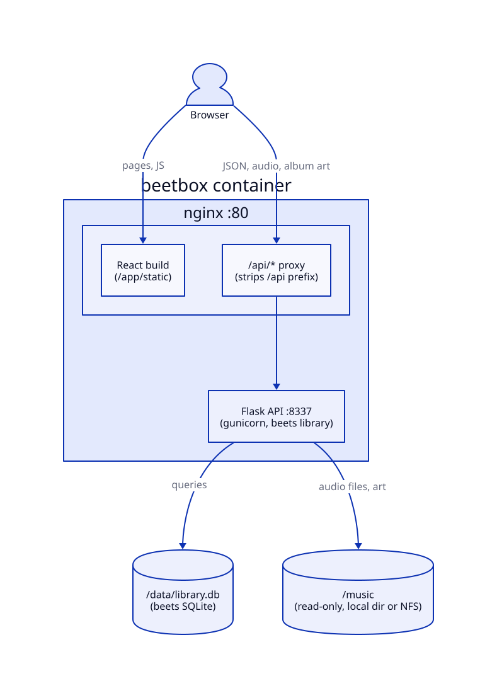

# Beetbox

A web interface for browsing and streaming a [beets](https://beets.io/) music library. A React/TypeScript frontend talks to a small Flask API that reads the beets SQLite database directly, based on the API from the beets `web` plugin. Everything ships as one container, with example Kubernetes manifests.

## Features

- Album browser with grid and list views and album art
- Artist browser with albums grouped per artist
- Track list with search
- HTML5 audio player that streams files from the library
- Search using beets query syntax
- Statistics page (track, album, artist and genre counts, total size and duration)
- Works on desktop and mobile

The API also supports updating track metadata (`PATCH`) and deleting items and albums when `READONLY=false`, but the UI does not expose editing or deleting yet.

## Quick start

### Docker Compose

The compose file lives in `docker/`, so point Compose at it and at your `.env`:

```bash
git clone https://github.com/Nonagon-Media/beetbox.git
cd beetbox

cp .env.example .env
# Edit .env: set MUSIC_PATH to the host music directory and add
# BEETS_DATA=<host directory that contains library.db>

docker compose --env-file .env -f docker/docker-compose.yml up -d
```

The UI is on http://localhost:8080. Port 8337 exposes the API directly and is optional.

The file paths stored in the beets database must resolve inside the container. The simplest setup is a beets library whose `directory` is `/music`, or a mount that keeps the same absolute path as on the host.

### Kubernetes

The manifests in `k8s/` are examples: a `beetbox` namespace, a single-replica Deployment, a NodePort Service (30080), a Traefik Ingress for `beetbox.local`, a read-only NFS volume for the music and a hostPath volume (`/opt/beetbox/data`) for the beets database.

```bash
# Set the image registry in k8s/deployment.yaml, the NFS server and path in
# k8s/pvc.yaml, and the host name in k8s/ingress.yaml, then:
kubectl apply -f k8s/
```

Copy `library.db` into the data volume before starting. The Deployment pulls from a private registry using an `ecr-creds` pull secret; drop `imagePullSecrets` if your registry does not need one.

## Configuration

Environment variables read by the API:

| Variable | Default | Description |
|----------|---------|-------------|
| `MUSIC_PATH` | `/music` | Path to music files |
| `BEETS_DB_PATH` | `/data/library.db` | Path to beets database |
| `HOST` | `0.0.0.0` | API bind address when running `app.py` directly (the container always binds 0.0.0.0) |
| `PORT` | `8337` | API port |
| `READONLY` | `true` | Disable write operations |
| `INCLUDE_PATHS` | `false` | Include file paths in API responses |
| `CORS_ORIGIN` | `*` | CORS allowed origins |

For Docker Compose, `MUSIC_PATH` and `BEETS_DATA` in `.env` are host paths that get mounted at `/music` (read-only) and `/data`.

## Architecture



One container runs two processes (`docker/start.sh`): nginx on port 80 serves the built React app and proxies `/api/*` to gunicorn on 8337, stripping the `/api` prefix. Album art responses get a one-day cache header. The Flask app opens the beets library per request, reads `/data/library.db` and serves audio and art from `/music`. `/health` checks the database and backs the Docker healthcheck and the Kubernetes probes.

## API endpoints

### Items (Tracks)

| Method | Endpoint | Description |
|--------|----------|-------------|
| GET | `/item/` | List all items |
| GET | `/item/<id>` | Get item by ID |
| GET | `/item/<id>/file` | Stream/download audio file |
| GET | `/item/query/<query>` | Search items (beets query syntax) |
| GET | `/item/path/<path>` | Get item by file path |
| GET | `/item/values/<field>` | Get unique field values |
| PATCH | `/item/<id>` or `/item/query/<query>` | Update item metadata |
| DELETE | `/item/<id>` or `/item/query/<query>` | Delete item (`?delete` also removes the file) |

### Albums

| Method | Endpoint | Description |
|--------|----------|-------------|
| GET | `/album/` | List all albums |
| GET | `/album/<id>` | Get album by ID |
| GET | `/album/<id>?expand` | Get album with tracks |
| GET | `/album/<id>/art` | Get album artwork |
| GET | `/album/query/<query>` | Search albums |
| GET | `/album/values/<field>` | Get unique field values |
| DELETE | `/album/<id>` or `/album/query/<query>` | Delete album (`?delete` also removes files) |

### Artists

| Method | Endpoint | Description |
|--------|----------|-------------|
| GET | `/artist/` | List all artists |

### Statistics

| Method | Endpoint | Description |
|--------|----------|-------------|
| GET | `/stats` | Get library statistics |
| GET | `/health` | Database health check |
| GET | `/` | API name, version and endpoint list |

Write operations return 405 while `READONLY=true` (the default). `<id>` accepts a comma-separated list of IDs. Behind nginx every path is prefixed with `/api`.

## Development

### Prerequisites

- Node.js 20+
- Python 3.11+
- Docker (optional)

### Frontend

```bash
cd frontend
npm install
npm run dev    # http://localhost:3000, proxies /api to localhost:8337
```

### Backend

```bash
cd backend
python -m venv venv
source venv/bin/activate
pip install -r requirements.txt
BEETS_DB_PATH=/path/to/library.db MUSIC_PATH=/path/to/music python app.py
```

### Building the image

```bash
docker build -t beetbox:latest -f docker/Dockerfile .
```

## License

MIT. See [LICENSE](LICENSE).

## Acknowledgments

- [beets](https://beets.io/), the music library manager this project builds on
- The original beets `web` plugin by Adrian Sampson, which the API is based on
